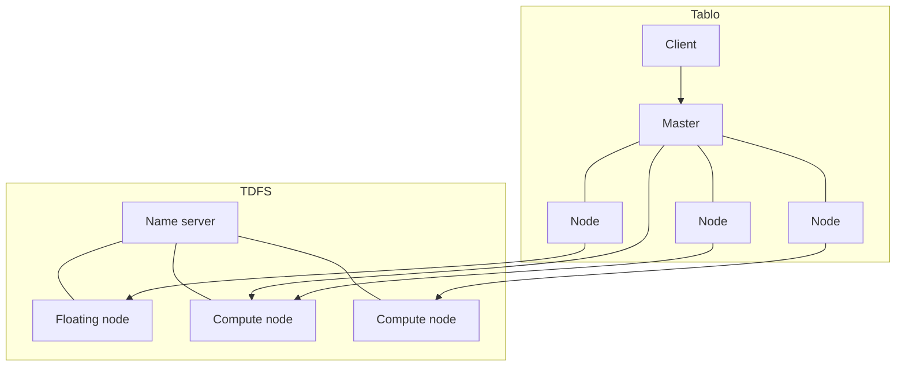

# Introduction

Tablo is a distributed big data system to analyze your CSV files efficiently over multiple servers.

Tablos performance is not dependent on the size of the file it is dependent on how fast your hardware is.
This is achieved by splitting your file over multiple nodes, working in parallel, managed by the master to ensure efficient distribution.
That minimizes workload on your personal less powerfull machine and enables a smooth workflow.
Each part of the [**Tablo core project**](https://github.com/Sobottasgithub/Tablo) will be explained below.

## What Tablo consists of

Tablo consists of the **Tablo core project**, that provides the client, master and node.
The Tablo master and node work hand in hand with TDFS to ensure redundant file storage.

Two projects, six roles:

| Role           | Project | Job                                                                            |
| -------------- | ------- | ------------------------------------------------------------------------------ |
| Client         | Tablo   | User interface. Connects to the master and executes operations.                |
| Master         | Tablo   | Access point for the client. distributes the workload over the nodes           |
| Nodes          | Tablo   | The heavy lifting. Executes TQL queries on the actual file snippets            |
| Name server    | TDFS    | Holds information about the location of each file snippet                      |
| Compute nodes  | TDFS    | Hold the distributed file storage itself. Serves as an access point for Tablo. |
| Floating nodes | TDFS    | Serves as an access point for Tablo. Can **not** store files                   |

### The client

The Tablo client acts as the user interface to access the Tablo master.

The workload only consists of rendering the user interface and holding a connection to the master.
This minimizes the workload on your own personal machine and ensures a smooth user experience on
devices with less compute power. If a Tablo cluster already exists on your server, the client is
"plug-and-play" ready. You only need to provied the server IP address and port and you are ready
to start with big data operations.

### The master

The Tablo master acts as the access point for the client and distributes the workload over the
nodes.

It acts as a pre-interpreter for all operations performed by the client. This means that it creates
an execution plan, for every TQL query the client executes.
If a file is uploaded from the client, the master will pass it to a TDFS node. The file can then be accessed by the nodes.
If necessary, the Tablo master can scale nodes at its own discretion.

### The node

The Tablo node does the heavy lifting and executes the TQL queries, that are pre-interpreted by the
master, on the actual file snippets. The file snippets are pulled from a TDFS node on its own.
Nodes are easily scalable because they are stateless. They simply perform the calculations assigned
to them by the master and return the results. Since they work exclusively on file snippets, maximum
efficiency is achieved.

## How your data gets there

The files are uploaded via the client over the master to TDFS, and then accessed by the nodes.
This way the workload on the client stays as minimal as possible by only providing the file once.

Workflow:

1. **Client** you hand the file to the interface.
2. **Master** the file is passed to the fastest TDFS node.
3. **TDFS** Decides how to distribute the file and stores the information in the name server.
4. **Nodes** accesses the file snippets via a TDFS node.

:::note

This page outlines what Tablo should be once it is fully finished. See
[TQL](https://github.com/Sobottasgithub/TQL) and [TDFS](https://github.com/Sobottasgithub/TDFS)
for the component projects, and [Sobottasgithub/Tablo](https://github.com/Sobottasgithub/Tablo)
for the core.

:::
