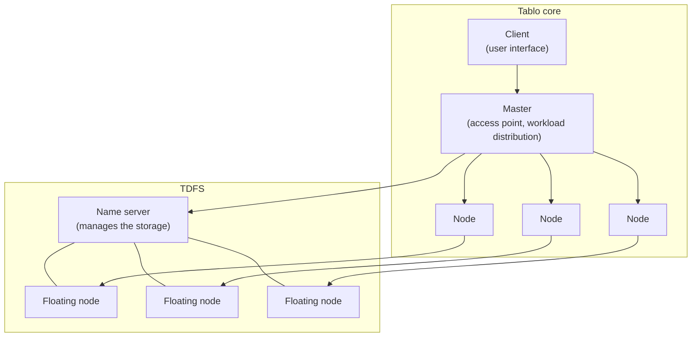

# Project Overview: Tablo

Tablo is a distributed big data system to analyze your CSV files efficiently. To analyze your
files efficiently, Tablo distributes your files over multiple servers.

That single sentence carries the whole idea. A CSV file big enough to matter is too big for one
machine to chew through in a reasonable time, so Tablo stops treating the file as one object. It
is split, spread across servers, and worked on in parallel — and the pieces of software that make
that happen are described below.

## What Tablo consists of

Tablo consists of the **Tablo core project**, that provides the client, master and node, and
**TDFS**, that manages the distributed file storage consisting of a name server and
compute/floating nodes.

Two projects, five roles:

| Role                   | Lives in   | What it does                                                                   |
| ---------------------- | ---------- | ------------------------------------------------------------------------------ |
| Client                 | Tablo core | User interface only — accesses the Tablo master and manages your data analysis |
| Master                 | Tablo core | Access point for the client; distributes the workload over the nodes           |
| Node                   | Tablo core | The heavy lifting — executes TQL queries on the actual file snippets           |
| Name server            | TDFS       | Manages the distributed file storage                                           |
| Compute/floating nodes | TDFS       | Hold the distributed file storage itself                                       |

### The client

The Tablo client only acts as a user interface to access the Tablo master and manage your data
analysis.

The word _only_ is doing real work in that sentence. The client is not a small analysis engine
with a window around it; it does not parse your file, it does not run your query, it does not hold
your data. It is the surface you work on — you point it at a master, you hand over files, you
write queries, you read results back. Everything expensive happens elsewhere, on purpose.

### The master

The Tablo master acts as the access point for the client and distributes the workload over the
nodes.

So the master wears two hats. Facing the client it is _the_ address — the one endpoint a user
talks to, which is why a client never needs to know how many nodes exist or where they are.
Facing the cluster it is the dispatcher: it takes the work implied by a query and divides it among
the nodes that will actually perform it.

### The node

The Tablo node does the heavy lifting and executes the TQL queries, that are preinterpreted by the
master, on the actual file snippets.

Three things are worth pulling out of that:

- **The node is where the compute happens.** "Heavy lifting" is the node's whole job description.
- **The query arrives preinterpreted.** A node is not each handed raw TQL text to figure out from
  scratch; the master has already interpreted it, and the node executes that.
- **A node works on file snippets, not files.** It sees a piece of your data — which is exactly
  what makes running many nodes at once worthwhile.

## How your data gets there

The files are uploaded via the client over the master to TDFS, and then accessed by the nodes.
This way the workload on the client stays as minimal as possible.

Read as a path, an upload goes:

1. **Client** — you hand the file to the interface.
2. **Master** — the file travels over the access point.
3. **TDFS** — where it comes to rest, distributed across the storage.
4. **Nodes** — which access it there when a query runs.

The payoff is stated in the author's own last clause: the workload on the client stays as minimal
as possible. Your data goes into the cluster once and is read by the machines that were built to
read it. The client is never asked to be a data pipeline — and because nodes reach into TDFS
directly, results are not funnelled back through your machine to be computed.

## Scaling

The Tablo nodes and the TDFS floating nodes are easily scalable, to adjust dynamically when user
capacity hits the maximum.

Note which two roles are named: Tablo nodes and TDFS floating nodes — the compute and the storage.
Those are the parts you add more of. And the trigger named is _user capacity hitting the maximum_:
scaling here answers demand, dynamically, rather than being a number you have to guess correctly
when the cluster is first set up.

## TQL

TQL is nothing to be afraid of. If you know how to work with SQL, you know how to work with TQL.
The only difference that you will notice is that you join CSV files instead of tables.

That is the design goal in plain terms: no new mental model. The query language you already have
in your head transfers, and the one adjustment is what sits on either side of a join. Where SQL
joins tables, TQL joins CSV files — which is consistent with everything above, because files are
what Tablo takes in, distributes and hands to its nodes.

:::note

This page outlines what Tablo should be once it is fully finished. See
[TQL](https://github.com/Sobottasgithub/TQL) and [TDFS](https://github.com/Sobottasgithub/TDFS)
for the component projects, and [Sobottasgithub/Tablo](https://github.com/Sobottasgithub/Tablo)
for the core.

:::
